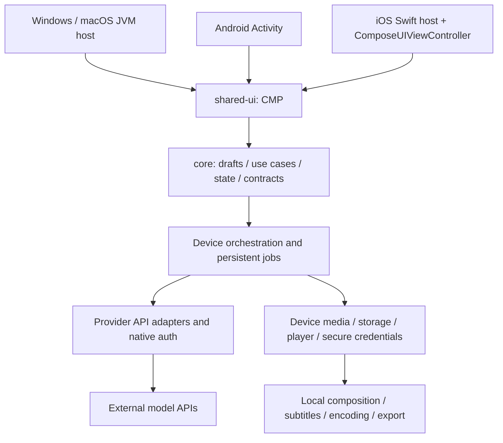

# Project Montage → Kotlin Multiplatform / Compose Multiplatform

## 基线与本次交付

2026-10-13 检查的私有仓库当时名为 `ak-ing/project-montage-private`。2026-10-16 用户将其改名为 `ak-ing/project-montage` 并公开，仓库 ID `1349344394`、分支和历史 CI 均保留，本地 origin 已同步。初始分支 `work`，远端 `rewrite/kmp` 指向 `dc1fc90af071af6ae24242a5b3a2b54831320387`；工作区干净后切换并设置跟踪。
从 `https://github.com/google/project-montage.git` 获取 `upstream/main`，以 fast-forward 合入 3 个提交，基线为 **`19de972cadefabfc18920a95b873b3cfb6f9a3a6`**。没有强制重置、改写历史或推送远端。

原版目录原地保留；相对该同步基线的新增实现位于 `kmp/`。上游同步本身包含删除旧 App Engine YAML 等变更，属于 Google 提交，不是迁移删减。今后用 `git diff 19de972 -- mcp_client mcp_montage sign_server deploy third_party` 检查保留情况。

当前已交付分析、协作规则、共享草稿模型与测试、CMP 示例界面、三个宿主（桌面覆盖 Windows/macOS，另含 Android、iOS）及骨架四端 UI 冒烟。已有单工作区本地保存/重载和任务检查点中断恢复；此前的四端导入基线已验证本地选择器、应用内副本、素材引用保存/恢复、移除及文件不可用提示。本次分镜格式升级为 schema 3，schema 1/2 的共享原子迁移逻辑已在四端单测通过。现已实现真实视频时长/尺寸/旋转/音轨读取、解码缩略图、播放/暂停/跳转/重播及错误重试，此前的四端预览与清理基线已通过；当前分镜版本已通过四端 UI、恢复与清理检查，实际范围见 [VALIDATION.md](VALIDATION.md)。真实生成、任务执行器、视频语义分析、凭据接入、拼接与导出仍未实现。最终产品能力见下表。

## 已确认的产品架构

用户明确要求**不部署自建后端，应用在设备端运行**，并允许**设备直接调用外部模型 API**。设备负责流程编排、会话与任务持久化、素材管理、转场/混音/字幕/编码、预览与导出；模型推理由模型服务商提供。

四端应用不得依赖自行运营的 ADK/MCP HTTP 服务、数据库、GCS 签名服务或 Cloud Run。原版服务目录保留为行为和协议参考，其部署机制不属于目标产品的必需基础设施。各模型 API 是否允许原生客户端直连、支持何种用户认证、是否需要服务身份，必须逐项验证；不能因为某接口不支持直连而默认增加代理后端。

## 原工程结构与运行链路

| 模块/证据 | 职责 | 运行依赖与状态 |
| --- | --- | --- |
| `mcp_client/server.py`, `frontend/` | FastAPI 落地页、版本、会话入口，挂载 ADK dev-ui | Python ≥3.13，8000；前端还使用 CDN 样式/图标/字体/Three.js |
| `mcp_client/adk/project_montage/`, `hotel_story/` | 两套 OrchestratorAgent、Google Search、提示词、前后回调 | ADK、Gemini；MCP HTTP/SSE/stdio；生产使用服务身份 |
| `mcp_client/utils/state.py`, `forking.py`, `fork_link.py`, `iap_identity.py` | 上传图片/GCS 状态、会话分叉、IAP 显示身份 | 内存会话或可选 PostgreSQL/Cloud SQL；fork 重放不能污染 app:/user: 共享状态 |
| `mcp_montage/server.py`, `tools/` | 注册 13 个 MCP 工具 | 8001，FastMCP/ASGI；以实际代码注册名为准 |
| `mcp_montage/schemas/` | 分镜、图片、视频、音频、旁白和音色协议 | dataclass/Pydantic；需保留宽松输入兼容与 wire 字段名 |
| `mcp_montage/services/`, `services/agents/` | 模型调用、提示词、并行生成、重试和媒体流水线 | Gemini、Veo、Omni、Lyria、TTS；Google GenAI/Storage |
| `mcp_montage/utils/` | FFmpeg/ffprobe、混音、字幕、存储、图像处理、日志 | FFmpeg/libass/fontconfig、Pillow、NumPy、Torch/torchaudio/MMS_FA |
| `sign_server/server.py` | GCS V4 签名 URL、307 下载重定向 | 8080；ADC/IAM signing；必须限制到配置 bucket |
| `deploy/`, `ONBOARDING.md`, Dockerfiles | 原版 GCP Cloud Run/IAP/Cloud Build/Cloud SQL 等部署 | 保留参考实现；不是设备端产品的运行依赖或部署目标 |
| `third_party/fonts/consolidated/` | 多语言字幕字体 | Noto，OFL；日中韩、阿拉伯、希伯来、天城文、泰文等 |

原版流水线：用户文本/图片 → 会话与代理规划 → 分镜/素材 → 图像 → Veo/Omni 视频 → 转场拼接 → 旁白/配音/配乐 → 字幕与混音 → GCS 成片与签名下载。
`config.yaml` 当前文本模型为 `gemini-3.5-flash`、图片为 `gemini-3.1-flash-image`、Veo 为 `veo-3.1-generate-001`。它们是上游配置而非客户端固定枚举；Omni/Lyria/TTS 也通过设备端提供商适配器的能力信息暴露，直连可用性尚未验证。

## 功能保真矩阵（全部保留）

“后续”表示当前骨架未实现。保留全部 13 个工具对应的产品能力与两套编排模式，迁移执行位置；四端通过共享 UI、设备用例和平台/提供商接口完成流程。特定模型的认证或平台限制须明确记录为缺口，不得伪报支持。

| 能力 / 源码依据 | 共享部分与实现边界 | 后续验收 |
| --- | --- | --- |
| 项目/会话、聊天、ADK 事件、历史，`mcp_client/server.py` | 共享会话状态、事件合并；设备端编排与本地持久化 | 恢复不重复事件，错误/取消明确，重启后能读取项目与任务 |
| 会话分叉与链接，`utils/forking.py` | 设备端 lineage、深拷贝/事件重放；本地导航与可导入导出的项目引用 | 不修改原会话，不重放 app:/user: 状态，缺失/冲突错误明确；跨设备引用需携带项目数据 |
| Montage 与 hotel_story，Google Search，两个 agent 目录 | 提示词、工具编排与模式选择迁到共享设备用例；搜索经支持的提供商 API | 两套场景完整生成，搜索结果可追踪，无 Python 服务依赖 |
| 上传/选择素材，`utils/state.py`, `select_asset` | 系统 picker + 不透明素材句柄；本地缓存，仅按模型 API 需要上传到提供商 | 多图、取消、权限拒绝、失败重试、引用素材一致，不要求自建 bucket |
| `generate_storyboard_by_text`, `generate_storyboard_by_image` | 共享分镜模型/编辑/校验；设备端组织请求并直连模型 API | 文本与图片输入，场景顺序、时长、风格及转场保留 |
| `generate_images`, `resize_image` | 设备端模型 API 适配器与本地图像处理；能力查询区分生成/扩展与缩放/裁切 | 参考图一致性、受限并发、裁切/扩展、部分失败 |
| `generate_videos` | 设备端 Veo 适配器、轮询与任务持久化 | 验证直接认证/调用；首帧、声音/时长/画幅、取消与中断恢复 |
| `generate_videos_omni`, `generate_videos_with_references_omni` | 设备端 Omni 适配器、能力选择与引用 | 验证直接认证/调用；首帧与多参考图两种路径 |
| `concatenate_videos` | 共享时间线/转场参数；平台媒体适配器在设备上执行 | `none` 和全部上游 xfade 效果逐项验证；缓冲消耗而非裁掉正文 |
| `generate_narrative` | 设备端编排直连文本模型；旁白/字幕编辑与字幕构造在本地 | 时间轴与多语言、文本修订、字数预算保持 |
| `generate_voiceover` | 设备端 TTS API 适配器；本地对齐或提供商返回时间戳，按能力验证 | 音色档案、字幕对齐、静音区间、多语言；不能假设手机可运行原版 Torch |
| `generate_bgm` | 设备端 Lyria 适配器、配乐选项与试听 | 验证直接认证/调用；与主题及长度一致，失败可恢复 |
| `render_final_video` | 共享渲染配置/进度；设备执行混音、字幕渲染与编码 | BGM/voiceover/subtitle 每项可选及组合，音量/响度保真，内存与温控可控 |
| 媒体预览、下载、分享，原版 `sign_server/server.py` | 本地媒体句柄、播放器、系统保存/分享；需要时下载提供商结果 | 本地 seek、导出、权限；提供商 URL 过期恢复，不依赖自建签名服务 |
| 提供商身份、凭据、资源隔离与版本展示 | 原生客户端认证或用户自行配置凭据，平台安全存储；本地项目隔离与版本信息 | 不内置共享密钥/服务身份；不要求 IAP、Cloud SQL、GCS 或 Cloud Run |
| 多语言字体、可访问性、窗口适配 | 共享 CMP 布局与文案；键盘/触控/系统无障碍适配 | 手机/平板/桌面，RTL 与字幕缺字回退 |

## 可共享逻辑与平台边界

- `core`：分镜/素材/会话领域模型、时间计算、输入校验、状态机、错误映射；已有工作区文档、存储接口、repository 和检查点恢复规则，后续增加可取消用例、工具编排、事件去重与重试。提供商 DTO 经适配器转换，避免直接绑定 UI。
- `shared-ui`：CMP 导航、表单、分镜列表、任务/会话状态、错误/加载/空态。当前支持草稿编辑和单工作区显式保存/重载，未连接模型 API。
- 网络：通过 Ktor 公共请求定义 + 平台 engine 直接访问支持的模型 API。逐项核实模型/区域/用户认证/配额/计费与上传下载协议；只支持服务器服务身份的接口记为待解决缺口。无自建 ADK/MCP 服务连接要求，不在手机运行 Python subprocess/stdio。
- 平台层：Android Photo Picker/SAF、Media3、Keystore；iOS Photos/文件访问、AVPlayer、Keychain、share sheet；Windows/macOS 文件选择、系统凭据、视频播放与导出。桌面评估 FFmpeg，移动端评估原生媒体 API 或可分发的原生库；转场、ASS/多语言字幕、对齐不能仅凭库名认定等价。实现前核实功能、许可证、最小系统版本与设备资源；这不是已实现依赖清单。
- 编排与资源：将原版代理/工具行为迁为设备用例；默认采用保守并发，按设备资源限制并行与缓存。任务保存提供商 operation ID 和本地阶段，支持取消、失败重试、进程重启恢复；遵守 Android/iOS 后台限制，不承诺退到后台后无限执行或轮询。
- 凭据与存储：不内置公共 API key、ADC、服务账号 JSON 或签名私钥。使用提供商支持的原生认证或用户输入凭据，并存入系统安全存储。项目/媒体默认存本地，不要求 GCS；提供商临时存储仅在其接口需要时使用。既有 Python 服务继续保留作参考，设备端产品不需部署它们。
- Windows/macOS 用 CMP Desktop/JVM，非 Kotlin/Native 桌面 UI。iOS 用 Kotlin/Native + CMP，由 Swift 宿主承载；`iosArm64` 与 `iosSimulatorArm64`。Intel Mac 上的 iOS x64 模拟器不在当前 CMP 支持矩阵里；Apple Silicon 模拟器已通过骨架 UI 冒烟，真机待验证。

## 迁移阶段与退出条件

1. **本次：基线与骨架**。上游同步、文档、各端入口、共享草稿与测试；完成当前平台可执行检查，记录未验证项。
2. **设备契约与直连可行性**。固定原版事件/工具 schema 与行为样例，定义本地项目、任务、素材和提供商/媒体接口；逐项核实 API 原生认证及移动端媒体能力，列出可用/受限/未验证项。实现本地会话列表/历史/版本/媒体读取；使用固定响应验证协议，不要求启动原版服务。
3. **设备端完整纵向流程**。先用本地素材完成四端选择→拼接→预览→导出；再接入用户凭据与一条已验证的模型 API，实现分镜→素材生成→本地成片。覆盖 fork、持久化、重启恢复、失败与取消；付费实测另按明确授权执行。
4. **生成与后期扩展**。覆盖全部 13 工具能力、两套编排模式、图片/视频/Omni references、配乐/字幕/配音/渲染。为缓冲时长、音频对齐、字幕截图和成片参数做 golden/契约验证，记录各平台资源上限和提供商限制。
5. **平台完善与发行**。权限、后台/中断恢复、播放器、保存分享、Windows/macOS 打包签名、Android/iOS 签名与实机测试、无障碍、性能、第三方许可清单。全功能矩阵通过后才讨论替换旧 UI；原版保留至迁移验收。

本地预览与分镜编辑里程碑已通过四端验收：素材关联、顺序调整、毫秒级片段入点/出点，以及保存恢复、引用保护和解除后清理均已核验。设备端基础裁切、拼接和编码已开始：共享请求契约、桌面 JavaCV、Android Media3 和 iOS AVFoundation 适配器均已加入；桌面真实输出与取消清理测试通过，Android 构建/UI 通过，iOS 在 41161786210 重跑中构建、核心测试和五项 UI 通过。下一步接入系统保存/分享，用自生成素材在四端验证实际成片时长、画面顺序、音频/静音、取消/失败清理与重启恢复，再接入模型 API 直连和用户凭据。各步骤均保持无自建后端，不以编辑决定或预览成功代替实际生成/导出验收。

当前进度与后续具体验收边界：

- **分镜编辑（已验收）**：每个分镜可选择已导入素材、调整顺序、设置片段入点/出点；校验区间非空且不越过视频时长。成功保存后重启恢复同样的关联、顺序和区间，保留未保存编辑/明确丢弃规则；移除素材不能悄悄留下失效引用。必要的文档升级须保留旧草稿和任务检查点。
- **基础成片**：以自生成不同颜色片段验证设备端按顺序拼接、裁切和导出，核对成片时长与画面，覆盖取消、失败和临时文件清理。先验收基础拼接，原版完整转场、混音、字幕仍按总功能矩阵分批实现。
- **模型直连**：只在一个提供商的原生认证/直连能力已核实后接入用户凭据、安全存储和可恢复任务；真实付费调用须另有明确授权。没有新增自建后端的前置步骤。

基础成片的准备情况（2026-10-26，尚未实现或加入依赖）：桌面评估现有 FFmpeg 8.1.2 的实际编码能力；Android 候选 Media3 的[官方 Maven 元数据](https://dl.google.com/dl/android/maven2/androidx/media3/media3-transformer/maven-metadata.xml)及[1.11.1 发布记录](https://github.com/androidx/media/blob/1.11.1/RELEASENOTES.md)已核对为当前最新稳定版，发布包摘要一致、最低 API 23 满足当前应用 API 24。其[取消接口](https://github.com/androidx/media/blob/1.11.1/libraries/transformer/src/main/java/androidx/media3/transformer/Transformer.java)不会删除输出，设备适配器须清理自己创建的未完成文件。iOS 候选为系统 AVMutableComposition/AVAssetExportSession，需保持 iOS 15 可用 API。实施顺序为共享的可取消任务与输出契约、桌面实际编码、移动端媒体适配及系统保存/分享，最后用四端成片时长/颜色/有声与静音混排/失败清理验收；这些预研不计为已支持导出。

## 当前原版已识别的验证风险

- 根 `.gitignore` 忽略 `tests/*`，仓库未带 README 所称的 `tests/` 测试套件；不能报告 pytest 通过。新测试放 `kmp/core/test/`。
- 原版 README 某些模型/暖机路由描述落后于代码；例如签名服务实际只有 `/view`，以同步后的源码为准。
- 原版 Python 清单要求 ≥3.13，而 Docker 基础镜像使用 3.11；uv 可能另行下载符合版本的解释器。运行原版参考服务时需核实实际解释器，设备端目标不依赖该镜像。
- 直连模型仍需要提供商 API 权限、配额与计费；原版使用服务身份并不证明原生客户端可直接使用所有模型。未进行真实认证/付费生成验证。
- 原版 FFmpeg/libass/Torch 流水线不能直接视为移动端可用实现。转场等价、多语言字幕、音频对齐、编码速度、内存、温控及后台限制必须分别验证；不能以增加自建服务器作为默认补救。
