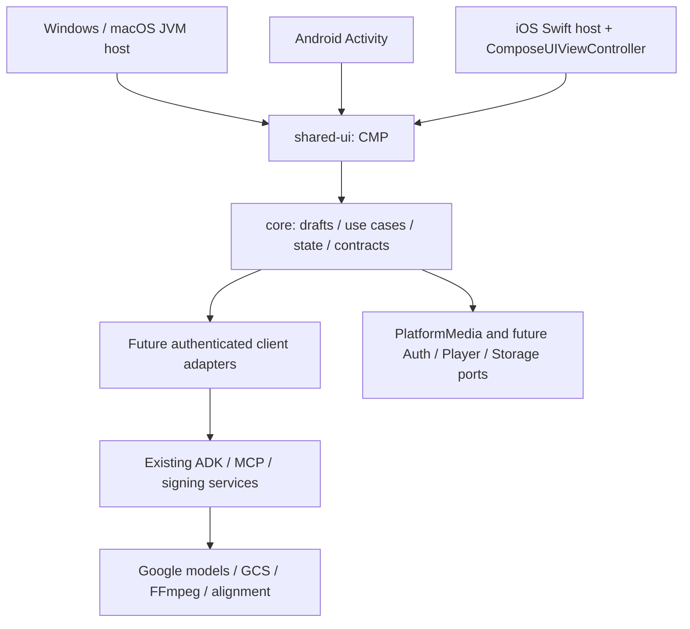

# Project Montage → Kotlin Multiplatform / Compose Multiplatform

## 基线与本次交付

2026-10-13 检查的私有仓库为 `ak-ing/project-montage-private`。初始分支 `work`，远端 `rewrite/kmp` 指向 `dc1fc90af071af6ae24242a5b3a2b54831320387`；工作区干净后切换并设置跟踪。
从 `https://github.com/google/project-montage.git` 获取 `upstream/main`，以 fast-forward 合入 3 个提交，基线为 **`19de972cadefabfc18920a95b873b3cfb6f9a3a6`**。没有强制重置、改写历史或推送远端。

原版目录原地保留；相对该同步基线的新增实现位于 `kmp/`。上游同步本身包含删除旧 App Engine YAML 等变更，属于 Google 提交，不是迁移删减。今后用 `git diff 19de972 -- mcp_client mcp_montage sign_server deploy third_party` 检查保留情况。

本次仅交付分析、协作规则、共享草稿模型与测试、CMP 示例界面和三个宿主（桌面覆盖 Windows/macOS，另含 Android、iOS）。不声称完成云端生成、媒体播放器、登录或导出。最终范围保持下表全部能力。

## 原工程结构与运行链路

| 模块/证据 | 职责 | 运行依赖与状态 |
| --- | --- | --- |
| `mcp_client/server.py`, `frontend/` | FastAPI 落地页、版本、会话入口，挂载 ADK dev-ui | Python ≥3.13，8000；前端还使用 CDN 样式/图标/字体/Three.js |
| `mcp_client/adk/project_montage/`, `hotel_story/` | 两套 OrchestratorAgent、Google Search、提示词、前后回调 | ADK、Gemini；MCP HTTP/SSE/stdio；生产使用服务身份 |
| `mcp_client/utils/state.py`, `forking.py`, `fork_link.py`, `iap_identity.py` | 上传图片/GCS 状态、会话分叉、IAP 显示身份 | 内存会话或可选 PostgreSQL/Cloud SQL；fork 重放不能污染 app:/user: 共享状态 |
| `mcp_montage/server.py`, `tools/` | 注册 13 个 MCP 工具 | 8001，FastMCP/ASGI；以实际代码注册名为准 |
| `mcp_montage/schemas/` | 分镜、图片、视频、音频、旁白和音色协议 | dataclass/Pydantic；需保留宽松输入兼容与 wire 字段名 |
| `mcp_montage/services/`, `services/agents/` | 模型调用、提示词、并行生成、重试和媒体流水线 | Gemini、Veo、Omni、Lyria、TTS；Google GenAI/Storage |
| `mcp_montage/utils/` | FFmpeg/ffprobe、混音、字幕、存储、图像处理、日志 | FFmpeg/libass/fontconfig、Pillow、NumPy、Torch/torchaudio/MMS_FA |
| `sign_server/server.py` | GCS V4 签名 URL、307 下载重定向 | 8080；ADC/IAM signing；必须限制到配置 bucket |
| `deploy/`, `ONBOARDING.md`, Dockerfiles | GCP Cloud Run/IAP/Cloud Build/Cloud SQL 等部署 | 不在客户端复制云运维；保留部署可用性为最终集成范围 |
| `third_party/fonts/consolidated/` | 多语言字幕字体 | Noto，OFL；日中韩、阿拉伯、希伯来、天城文、泰文等 |

流水线：用户文本/图片 → 会话与代理规划 → 分镜/素材 → 图像 → Veo/Omni 视频 → 转场拼接 → 旁白/配音/配乐 → 字幕与混音 → GCS 成片与签名下载。
`config.yaml` 当前文本模型为 `gemini-3.5-flash`、图片为 `gemini-3.1-flash-image`、Veo 为 `veo-3.1-generate-001`。它们是上游配置而非客户端固定枚举；Omni/Lyria/TTS 配置也须经后端能力查询逐步暴露。

## 功能保真矩阵（全部保留）

“后续”表示此次骨架未实现，绝不表示最终不支持。四端均须能通过共享 UI 与服务边界使用完整流程。

| 能力 / 源码依据 | 共享部分与实现边界 | 后续验收 |
| --- | --- | --- |
| 项目/会话、聊天、ADK 事件、历史，`mcp_client/server.py` | 共享状态、DTO、事件合并；后端 ADK 会话与持久化 | 重连不重复事件，错误/取消明确，内存与 DB 模式兼容 |
| 会话分叉与链接，`utils/forking.py` | 共享 lineage/导航；后端深拷贝重放到指定事件 | 不修改原会话，不重放 app:/user: 状态，404/409 语义保持 |
| Montage 与 hotel_story，Google Search，两个 agent 目录 | 共享模式选择与输出展示；提示词与工具编排在服务器 | 两套场景完整生成与搜索结果可追踪 |
| 上传/选择素材，`utils/state.py`, `select_asset` | 共享素材元数据与进度；系统 picker + GCS 上传授权 | 多图、取消、权限拒绝、失败重试、引用素材一致 |
| `generate_storyboard_by_text`, `generate_storyboard_by_image` | 共享分镜模型/编辑/校验；生成在后端 | 文本与图片输入，场景顺序、时长、风格及转场保留 |
| `generate_images`, `resize_image` | 共享请求/响应与画幅选择；模型处理在后端 | 参考图一致性、批量并行、裁切/扩展、部分失败 |
| `generate_videos` | 共享任务状态；Veo 调用、轮询在后端 | 首帧图生成、声音/时长/画幅与错误处理一致 |
| `generate_videos_omni`, `generate_videos_with_references_omni` | 共享能力选择与引用；Omni 调用在后端 | 首帧与多参考图两种路径，不遗漏新上游工具 |
| `concatenate_videos` | 共享时间线/转场参数；FFmpeg 执行在后端 | `none` 和所有上游 xfade 效果；额外缓冲消耗而非裁掉正文 |
| `generate_narrative` | 共享旁白/字幕展示编辑；生成与 ASS 处理在后端 | 时间轴与多语言、文本修订、字数预算保持 |
| `generate_voiceover` | 共享音色/任务配置；TTS、强制对齐在后端 | 音色档案、字幕对齐、静音区间、多语言 |
| `generate_bgm` | 共享配乐选项与试听；Lyria 在后端 | 与视频主题及长度一致，失败可恢复 |
| `render_final_video` | 共享渲染配置/进度；混音、烧字幕与编码在后端 | BGM/voiceover/subtitle 每项可选及组合，音量与响度保真 |
| 媒体预览、下载、分享，`sign_server/server.py` | 共享 URL 生命周期与播放器状态；播放/保存/分享平台化 | 过期 URL 刷新、Range/seek、系统保存、bucket 限制保持 |
| IAP/身份、GCS、部署与版本展示 | 共享用户状态/版本兼容；OAuth 与安全存储平台化，签名在后端 | 服务身份不下发客户端，隔离用户资源，Cloud Run 集成 |
| 多语言字体、可访问性、窗口适配 | 共享 CMP 布局与文案；键盘/触控/系统无障碍适配 | 手机/平板/桌面，RTL 与字幕缺字回退 |

## 可共享逻辑与平台边界

- `core`：分镜/素材/会话领域模型、时间计算、用户输入校验、状态机、错误映射；后续增加 serialization wire DTO、可取消协程、事件去重、重试策略、repository/use-case。避免把服务模型直接绑定 UI。
- `shared-ui`：CMP 导航、表单、分镜列表、任务/会话状态、错误/加载/空态。此次只实现内存草稿编辑，明确未连云端。
- 网络：以后以 Ktor 的公共请求定义 + 平台 engine 接入，先定义并测试 ADK/MCP 兼容适配层；不要把 Python subprocess/stdio 当成手机传输。SSE/Streamable HTTP 保留为服务接口。
- 平台层：Android Photo Picker/SAF、Media3、Keystore；iOS Photos/文件访问、AVPlayer、Keychain、share sheet；Windows/macOS 文件选择、系统凭据、视频播放和系统分享/下载。实现前核实可用库、许可证与最小系统版本；这不是已实现依赖清单。
- 后端：ADK、模型密钥/ADC、GCS 签名、FFmpeg/libass、Torch/强制对齐留在可信服务。最终 KMP 产品可以复用或逐步替换服务器，但不把 Python SDK 强行放入 common code。替换后端必须另立里程碑与行为等价测试。
- Windows/macOS 用 CMP Desktop/JVM，非 Kotlin/Native 桌面 UI。iOS 用 Kotlin/Native + CMP，由 Swift 宿主承载；`iosArm64` 与 `iosSimulatorArm64`。Intel Mac 上的 iOS x64 模拟器不在当前 CMP 支持矩阵里，真机与 Apple Silicon 模拟器待验证。

## 迁移阶段与退出条件

1. **本次：基线与骨架**。上游同步、文档、各端入口、共享草稿与测试；完成当前平台可执行检查，记录未验证项。
2. **服务契约与只读接入**。固定 ADK 事件样例、MCP tools/list 与工具 schema、签名错误响应；实现会话列表/历史/版本/媒体访问；用本地服务替身和原版做契约对比。
3. **会话/素材/分镜完整纵向流程**。登录、上传、两种分镜、fork、持久化、恢复；先验证一条跨四端完整链，再扩展而不删除能力。
4. **生成与后期**。全部 13 工具、代理模式、图片/视频/Omni references、配乐/字幕/配音/渲染。为缓冲时长、音频对齐、字幕截图和成片参数做 golden/契约验证。
5. **平台完善与发行**。权限、后台/中断恢复、播放器、保存分享、Windows/macOS 打包签名、Android/iOS 签名与实机测试、无障碍、性能、第三方许可清单。全功能矩阵通过后才讨论替换旧 UI；原版保留至迁移验收。

## 当前原版已识别的验证风险

- 根 `.gitignore` 忽略 `tests/*`，仓库未带 README 所称的 `tests/` 测试套件；不能报告 pytest 通过。新测试放 `kmp/core/test/`。
- 原版 README 某些模型/暖机路由描述落后于代码；例如签名服务实际只有 `/view`，以同步后的源码为准。
- Python 清单要求 ≥3.13，而 Docker 基础镜像使用 3.11；uv 可能另行下载符合版本的解释器，必须在后端部署阶段核实镜像中的实际解释器，不能仅凭基础镜像断言已验证。
- 实际 Google 模型/GCS/签名需要启用 API、权限、配额与计费；本次不请求生产凭据、不运行付费生成。
